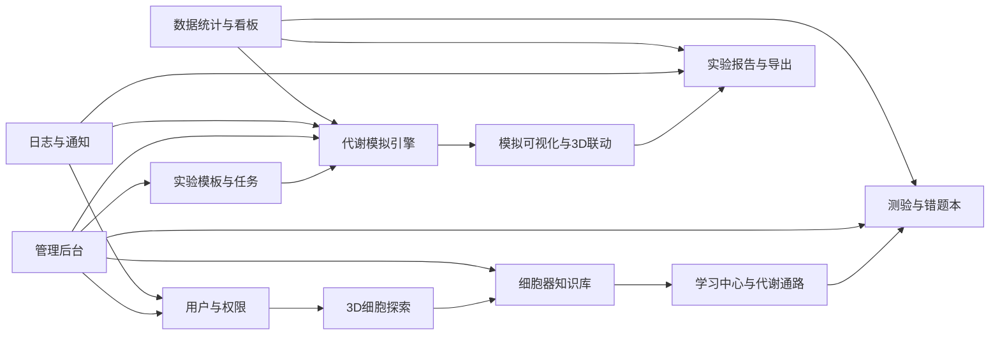
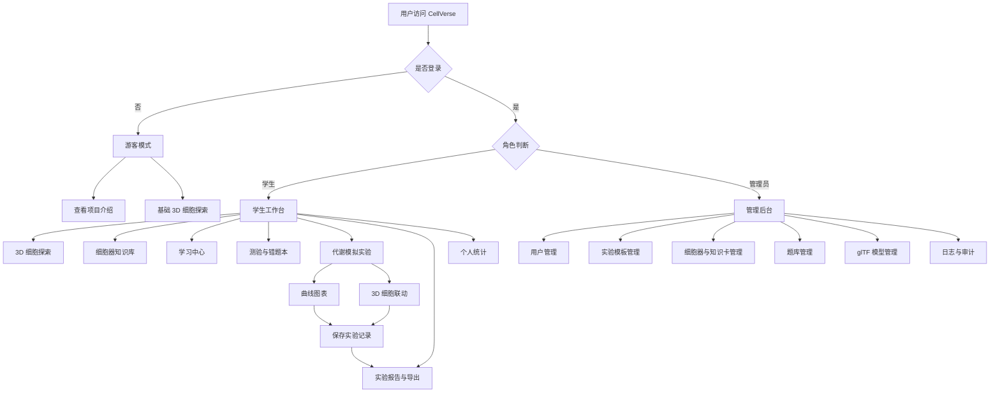
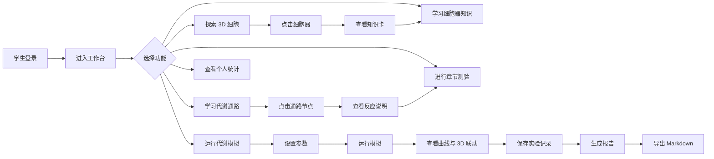
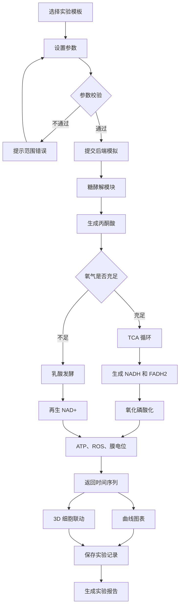
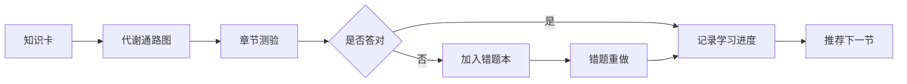
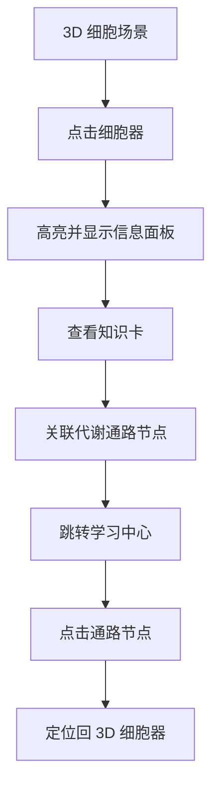
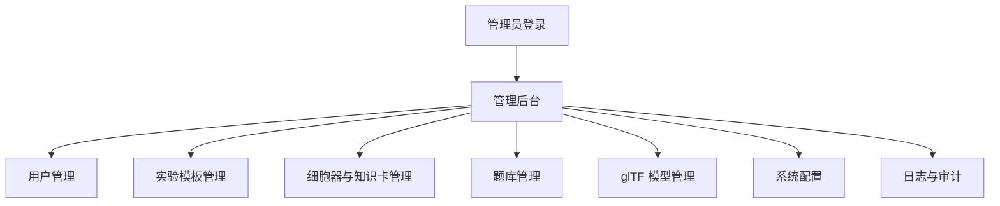

# CellVerse 需求规格说明书

**项目名称**：CellVerse  
**文档版本**：V1.2  
**编写日期**：2026-10-10  
**项目类型**：课程作业 / Web 应用  
**团队规模**：2~3 人  
**开发周期**：8 周  
**文档状态**：需求规格说明书完整版，可作为设计说明书输入

---

## 1. 引言

### 1.1 编写目的

本文档用于明确 CellVerse 的功能需求、非功能需求、外部接口、数据要求和验收标准，作为后续设计、开发、测试和答辩验收的依据。

### 1.2 项目范围

CellVerse 是一个基于 Web 的 3D 虚拟细胞探索与代谢模拟教学平台，主要面向学生。MVP 包含：

1. 用户注册、登录与权限管理。
2. 基于免费 glTF 模型的 3D 细胞结构展示。
3. 细胞器点击、旋转、缩放、信息查看。
4. 糖酵解 + TCA 循环 + 氧化磷酸化简化代谢模拟。
5. 模拟结果曲线与 3D 细胞实时响应。
6. 学习中心：知识卡、代谢通路、测验、错题本、学习进度。
7. 实验记录、报告生成与 Markdown 导出。
8. 数据统计看板、管理后台、日志与通知。

**不包含**：教师评分系统、科研级全细胞模拟、真实医学诊断、原生桌面端、多人协作。

### 1.3 术语定义

| 术语 | 含义 |
|---|---|
| 细胞器 | 细胞内具有特定功能的结构 |
| ATP | 三磷酸腺苷，细胞能量货币 |
| ADP | 二磷酸腺苷，ATP 水解产物 |
| NADH / FADH2 | 电子载体，参与氧化磷酸化 |
| ROS | 活性氧，过高导致氧化应激 |
| 糖酵解 | 葡萄糖分解为丙酮酸并产生少量 ATP、NADH |
| TCA 循环 | 三羧酸循环，产生 NADH、FADH2 |
| 氧化磷酸化 | 线粒体内电子传递链与 ATP 合酶产生 ATP |
| 电子传递链 | 复合体 I~IV，传递电子并泵出质子 |
| ATP 合酶 | 利用质子梯度合成 ATP |
| 膜电位 | 线粒体内膜电位，反映线粒体功能 |
| 2-DG | 2-脱氧葡萄糖，抑制糖酵解 |
| 鱼藤酮 | 抑制电子传递链复合体 I |
| 寡霉素 | 抑制 ATP 合酶 |
| FCCP | 解偶联剂，破坏质子梯度 |
| glTF | 一种 3D 模型文件格式 |
| ODE | 常微分方程 |
| MVP | 最小可行产品 |
| RBAC | 基于角色的访问控制 |
| JWT | JSON Web Token |

### 1.4 参考资料

1. 软件工程需求规格说明书模板。
2. Three.js、React Three Fiber、FastAPI 官方文档。
3. 细胞生物学教材中糖酵解、TCA 循环、氧化磷酸化章节。
4. glTF 免费模型许可说明（CC0 / CC-BY）。
5. 课程作业任务书与答辩要求。

---

## 2. 总体描述

### 2.1 产品愿景

CellVerse 将抽象的细胞结构和能量代谢转化为可交互的 3D Web 体验。学生可以“进入”细胞，点击细胞器，调节代谢参数，观察糖酵解、TCA 循环与氧化磷酸化的动态变化，并通过学习中心、测验和实验报告巩固知识。

### 2.2 目标用户

| 角色 | 说明 | MVP |
|---|---|---|
| 游客 | 查看公开介绍和基础 3D 演示 | 是 |
| 学生 | 主要用户，探索、模拟、学习、保存报告 | 是 |
| 管理员 | 用户管理、模板管理、日志查看 | 是 |
| 教师 | 查看报告、评分 | 否，未来扩展 |

### 2.3 运行环境

- 客户端：支持 WebGL 2.0 的现代浏览器。
- 推荐：Chrome、Edge、Firefox 最新版。
- 服务端：Linux / Windows Server，Docker 部署。
- 网络：HTTPS，JSON 通信。
- 分辨率：最低 1366×768，推荐 1920×1080。

### 2.4 设计约束

1. 必须为 Web 端，不开发原生桌面端。
2. 3D 模型使用免费 glTF 资源，需记录来源和许可。
3. 代谢模拟为教学简化模型，但术语和因果链应专业。
4. 后端负责模拟计算，前端负责 3D 渲染与图表。
5. 8 周内完成 MVP，教师端不纳入。
6. 报告导出优先 Markdown，PDF 为可选扩展。

### 2.5 假设与依赖

1. 浏览器支持 WebGL 2.0。
2. 可获取 CC0 或 CC-BY 许可的 glTF 细胞器模型。
3. 团队可使用 Three.js、React、FastAPI、SciPy 等开源技术。
4. 模拟公式参考教材简化设计。
5. 系统可部署在课程服务器或本地 Docker。

---

## 3. 功能需求

### 3.1 功能模块概览

| 编号 | 模块 | 核心职责 | 优先级 |
|---|---|---|---|
| FR-AUTH | 用户与权限模块 | 注册、登录、JWT、RBAC、个人中心 | 高 |
| FR-CELL | 3D 细胞探索模块 | glTF 加载、旋转缩放、点击细胞器 | 高 |
| FR-ORGA | 细胞器知识库模块 | 知识卡、结构功能、代谢关联、搜索 | 高 |
| FR-SIM | 代谢模拟引擎模块 | 糖酵解、TCA、氧化磷酸化、药物干预 | 高 |
| FR-VIS | 模拟可视化与 3D 联动模块 | 曲线、粒子、光晕、颜色、播放控制 | 高 |
| FR-EXP | 实验模板与任务模块 | 预设实验、参数模板、实验步骤 | 高 |
| FR-LEARN | 学习中心与代谢通路模块 | 通路图、节点说明、学习进度 | 高 |
| FR-QUIZ | 测验与错题本模块 | 题库、判分、解析、错题复习 | 高 |
| FR-REPORT | 实验报告与导出模块 | 保存记录、生成报告、Markdown 导出 | 高 |
| FR-STAT | 数据统计与看板模块 | 个人统计、全局统计、图表 | 中 |
| FR-ADMIN | 管理后台模块 | 用户、模板、细胞器、题库、配置 | 中 |
| FR-LOG | 日志与通知模块 | 操作日志、异常日志、站内通知 | 中 |

共 **12 个功能模块**。前 9 个为 MVP 核心，后 3 个可做轻量实现。

---

### 3.2 用户与权限模块 FR-AUTH

| 编号 | 需求名称 | 需求描述 | 优先级 |
|---|---|---|---|
| FR-AUTH-01 | 用户注册 | 用户名、邮箱、密码注册 | 高 |
| FR-AUTH-02 | 用户登录 | 登录成功返回 JWT | 高 |
| FR-AUTH-03 | 角色权限 | 学生、管理员；教师不纳入 MVP | 高 |
| FR-AUTH-04 | 个人中心 | 查看和修改昵称、头像、密码 | 中 |
| FR-AUTH-05 | 学习档案 | 展示学习进度、测验成绩、实验报告数 | 中 |
| FR-AUTH-06 | 退出登录 | 清除本地令牌 | 高 |
| FR-AUTH-07 | 权限校验 | 管理接口仅管理员可访问 | 高 |
| FR-AUTH-08 | 账号安全 | 密码哈希、登录失败限制、Token 过期 | 高 |

---

### 3.3 3D 细胞探索模块 FR-CELL

| 编号 | 需求名称 | 需求描述 | 优先级 |
|---|---|---|---|
| FR-CELL-01 | glTF 加载 | 加载免费 glTF 细胞器模型并组装细胞 | 高 |
| FR-CELL-02 | 旋转缩放平移 | 鼠标/触控板旋转、缩放、平移 | 高 |
| FR-CELL-03 | 细胞器点击 | 点击细胞器高亮并弹出信息面板 | 高 |
| FR-CELL-04 | 透明/剖面模式 | 切换细胞膜透明或剖面视图 | 中 |
| FR-CELL-05 | 细胞器列表 | 侧边栏列出细胞器，点击定位 | 中 |
| FR-CELL-06 | 重置视角 | 恢复默认视角 | 低 |
| FR-CELL-07 | 性能降级 | 低性能设备自动降低模型精度 | 中 |
| FR-CELL-08 | 全屏探索 | 支持全屏查看 3D 细胞 | 低 |

**MVP 细胞器范围**：细胞膜、细胞质、细胞核、线粒体、内质网、高尔基体、溶酶体、核糖体。

---

### 3.4 细胞器知识库模块 FR-ORGA

| 编号 | 需求名称 | 需求描述 | 优先级 |
|---|---|---|---|
| FR-ORGA-01 | 知识卡 | 每个细胞器一张知识卡 | 高 |
| FR-ORGA-02 | 结构说明 | 展示形态、位置、主要结构 | 高 |
| FR-ORGA-03 | 功能说明 | 展示细胞器功能 | 高 |
| FR-ORGA-04 | 代谢关联 | 关联糖酵解、TCA、氧化磷酸化 | 高 |
| FR-ORGA-05 | 术语解释 | 点击术语显示解释 | 中 |
| FR-ORGA-06 | 搜索 | 按名称、关键词搜索知识卡 | 中 |
| FR-ORGA-07 | 收藏 | 学生可收藏知识卡 | 低 |
| FR-ORGA-08 | 3D 定位 | 从知识卡跳转并定位到 3D 细胞器 | 中 |

---

### 3.5 代谢模拟引擎模块 FR-SIM

| 编号 | 需求名称 | 需求描述 | 优先级 |
|---|---|---|---|
| FR-SIM-01 | 实验模板选择 | 选择糖酵解、氧化磷酸化、药物抑制等模板 | 高 |
| FR-SIM-02 | 参数设置 | 葡萄糖、氧气、ADP、NAD+、药物、剂量、时长 | 高 |
| FR-SIM-03 | 糖酵解模拟 | 葡萄糖 → 丙酮酸，产 ATP、NADH | 高 |
| FR-SIM-04 | TCA 循环模拟 | 丙酮酸 → 乙酰 CoA → NADH、FADH2 | 高 |
| FR-SIM-05 | 氧化磷酸化模拟 | 电子传递链、质子梯度、ATP 合酶 | 高 |
| FR-SIM-06 | 药物干预 | 2-DG、鱼藤酮、寡霉素、FCCP | 高 |
| FR-SIM-07 | 结果指标 | ATP、ADP、NADH、FADH2、丙酮酸、乳酸、ROS、膜电位、存活率 | 高 |
| FR-SIM-08 | 参数校验 | 范围校验，非法值提示 | 高 |
| FR-SIM-09 | 模拟历史 | 查看历史模拟记录 | 中 |
| FR-SIM-10 | 模型配置 | 模拟参数集中配置，便于调整 | 中 |

**输入参数建议**：

| 参数 | 范围 | 默认 |
|---|---|---|
| 葡萄糖浓度 | 0~25 mM | 5 mM |
| 氧气浓度 | 0~21% | 21% |
| ADP 浓度 | 0~5 mM | 1 mM |
| NAD+ 水平 | 0~100% | 100% |
| 药物类型 | 无、2-DG、鱼藤酮、寡霉素、FCCP | 无 |
| 药物剂量 | 0~100 μM | 0 |
| 模拟时长 | 1~60 min | 10 min |

**简化模型原则**：

1. 糖酵解：葡萄糖 → G6P → 丙酮酸，净产 2 ATP、2 NADH。
2. 缺氧时丙酮酸 → 乳酸，NADH 再生。
3. 有氧时丙酮酸 → 乙酰 CoA → TCA 循环 → NADH、FADH2。
4. 氧化磷酸化：NADH/FADH2 → 电子传递链 → 质子梯度 → ATP 合酶 → ATP。
5. ROS 在复合体 I/III 电子泄漏时产生。
6. 药物作用：2-DG 抑制糖酵解；鱼藤酮抑制复合体 I；寡霉素抑制 ATP 合酶；FCCP 解偶联。
7. 后端使用 ODE 或离散时间步进，返回 JSON 时间序列。
8. 明确标注“教学简化模型，非科研精度”。

---

### 3.6 模拟可视化与 3D 联动模块 FR-VIS

| 编号 | 需求名称 | 需求描述 | 优先级 |
|---|---|---|---|
| FR-VIS-01 | 指标曲线 | 折线图展示 ATP、ROS、乳酸等随时间变化 | 高 |
| FR-VIS-02 | 多指标对比 | 同一图叠加或分图展示多个指标 | 高 |
| FR-VIS-03 | 3D 颜色映射 | ATP 低时线粒体变暗，ROS 高时红色光晕 | 高 |
| FR-VIS-04 | 粒子动画 | 葡萄糖进入、ATP 产生、ROS 泄漏 | 中 |
| FR-VIS-05 | 播放控制 | 播放、暂停、拖动时间轴 | 中 |
| FR-VIS-06 | 结果截图 | 保存当前 3D 画面 | 低 |
| FR-VIS-07 | 模拟对比 | 对比两次模拟结果 | 低 |
| FR-VIS-08 | 图例说明 | 颜色、亮度、粒子含义说明 | 中 |
| FR-VIS-09 | 异常状态提示 | ATP 过低、ROS 过高等提示 | 中 |

---

### 3.7 实验模板与任务模块 FR-EXP

| 编号 | 需求名称 | 需求描述 | 优先级 |
|---|---|---|---|
| FR-EXP-01 | 模板列表 | 展示所有实验模板 | 高 |
| FR-EXP-02 | 模板详情 | 展示实验目的、原理、步骤、参数建议 | 高 |
| FR-EXP-03 | 预设参数 | 一键载入推荐参数 | 高 |
| FR-EXP-04 | 实验目标 | 明确学生需要观察的指标 | 中 |
| FR-EXP-05 | 难度标签 | 基础、进阶、挑战 | 低 |
| FR-EXP-06 | 保存为记录 | 将当前模拟保存为实验记录 | 高 |
| FR-EXP-07 | 模板搜索 | 按关键词搜索模板 | 中 |
| FR-EXP-08 | 管理员维护 | 管理员增删改实验模板 | 中 |

---

### 3.8 学习中心与代谢通路模块 FR-LEARN

| 编号 | 需求名称 | 需求描述 | 优先级 |
|---|---|---|---|
| FR-LEARN-01 | 通路图 | 展示糖酵解、TCA、氧化磷酸化通路 | 高 |
| FR-LEARN-02 | 节点点击 | 点击通路节点查看反应说明 | 高 |
| FR-LEARN-03 | 反应说明 | 展示底物、产物、酶、能量变化 | 高 |
| FR-LEARN-04 | 知识卡关联 | 通路节点关联细胞器知识卡 | 高 |
| FR-LEARN-05 | 学习进度 | 记录已学知识卡和通路节点 | 中 |
| FR-LEARN-06 | 推荐学习 | 根据进度推荐下一节 | 低 |
| FR-LEARN-07 | 收藏与笔记 | 收藏节点，添加简单笔记 | 低 |
| FR-LEARN-08 | 术语表 | 汇总代谢相关术语 | 中 |

---

### 3.9 测验与错题本模块 FR-QUIZ

| 编号 | 需求名称 | 需求描述 | 优先级 |
|---|---|---|---|
| FR-QUIZ-01 | 题库 | 选择题、判断题 | 高 |
| FR-QUIZ-02 | 章节测验 | 按细胞器、糖酵解、氧化磷酸化分章 | 高 |
| FR-QUIZ-03 | 提交判分 | 自动判分并显示得分 | 高 |
| FR-QUIZ-04 | 答案解析 | 显示正确答案和解析 | 高 |
| FR-QUIZ-05 | 错题本 | 自动收集错题 | 中 |
| FR-QUIZ-06 | 错题重做 | 支持错题重做 | 中 |
| FR-QUIZ-07 | 成绩记录 | 保存历次测验成绩 | 中 |
| FR-QUIZ-08 | 随机组卷 | 从题库随机抽题 | 低 |

---

### 3.10 实验报告与导出模块 FR-REPORT

| 编号 | 需求名称 | 需求描述 | 优先级 |
|---|---|---|---|
| FR-REPORT-01 | 保存模拟 | 保存参数和结果 | 高 |
| FR-REPORT-02 | 报告生成 | 自动生成报告草稿 | 高 |
| FR-REPORT-03 | 报告编辑 | 编辑结论、分析、姓名、学号 | 中 |
| FR-REPORT-04 | Markdown 导出 | 导出 `.md` 文件 | 高 |
| FR-REPORT-05 | PDF 导出 | 可选扩展 | 低 |
| FR-REPORT-06 | 报告模板 | 固定 Markdown 模板 | 中 |
| FR-REPORT-07 | 报告列表 | 查看历史报告 | 高 |
| FR-REPORT-08 | 删除报告 | 学生可删除自己的报告 | 低 |

**Markdown 报告结构**：实验名称、目的、参数、曲线、3D 截图、结果分析、结论、提交时间。

---

### 3.11 数据统计与看板模块 FR-STAT

| 编号 | 需求名称 | 需求描述 | 优先级 |
|---|---|---|---|
| FR-STAT-01 | 个人统计 | 模拟次数、报告数、测验平均分 | 中 |
| FR-STAT-02 | 学习进度统计 | 知识卡、通路、测验完成度 | 中 |
| FR-STAT-03 | 模拟指标分布 | ATP、ROS、存活率分布 | 中 |
| FR-STAT-04 | 全局统计 | 用户数、模拟次数、报告数 | 低 |
| FR-STAT-05 | 图表展示 | 柱状图、折线图、饼图 | 中 |
| FR-STAT-06 | 时间筛选 | 按日、周、月筛选 | 低 |
| FR-STAT-07 | 导出统计 | 导出 CSV 或 Markdown | 低 |

---

### 3.12 管理后台模块 FR-ADMIN

| 编号 | 需求名称 | 需求描述 | 优先级 |
|---|---|---|---|
| FR-ADMIN-01 | 用户管理 | 查看、禁用、删除用户 | 中 |
| FR-ADMIN-02 | 角色管理 | 管理学生、管理员角色 | 中 |
| FR-ADMIN-03 | 实验模板管理 | 增删改实验模板 | 中 |
| FR-ADMIN-04 | 细胞器管理 | 维护细胞器和知识卡 | 中 |
| FR-ADMIN-05 | 题库管理 | 增删改测验题 | 中 |
| FR-ADMIN-06 | glTF 模型管理 | 上传、替换、记录模型来源和许可 | 中 |
| FR-ADMIN-07 | 系统配置 | 模拟参数范围、默认值配置 | 中 |
| FR-ADMIN-08 | 数据清理 | 清理过期模拟记录和日志 | 低 |
| FR-ADMIN-09 | 操作审计 | 查看管理员操作记录 | 中 |

---

### 3.13 日志与通知模块 FR-LOG

| 编号 | 需求名称 | 需求描述 | 优先级 |
|---|---|---|---|
| FR-LOG-01 | 操作日志 | 登录、模拟、保存报告 | 中 |
| FR-LOG-02 | 异常日志 | 后端异常、前端错误 | 中 |
| FR-LOG-03 | 登录日志 | 登录成功、失败记录 | 中 |
| FR-LOG-04 | 站内通知 | 模拟完成、报告生成提示 | 低 |
| FR-LOG-05 | 通知已读 | 标记已读、全部已读 | 低 |
| FR-LOG-06 | 日志查询 | 按用户、时间、类型筛选 | 中 |
| FR-LOG-07 | 日志清理 | 定期清理过期日志 | 低 |

---

### 3.14 模块关系简图



---

### 3.15 优先级与 8 周落地建议

**核心 MVP，必须完成：**

1. FR-AUTH 用户与权限
2. FR-CELL 3D 细胞探索
3. FR-SIM 代谢模拟引擎
4. FR-VIS 模拟可视化与 3D 联动
5. FR-LEARN 学习中心与代谢通路
6. FR-REPORT 实验报告与 Markdown 导出

**重要扩展，尽量完成：**

7. FR-ORGA 细胞器知识库
8. FR-EXP 实验模板与任务
9. FR-QUIZ 测验与错题本

**轻量实现，答辩加分：**

10. FR-STAT 数据统计与看板
11. FR-ADMIN 管理后台
12. FR-LOG 日志与通知

---

### 3.16 功能介绍（流程图展示）

#### 3.16.1 系统总体功能流程图



#### 3.16.2 学生核心使用流程



#### 3.16.3 代谢模拟详细流程



#### 3.16.4 学习中心闭环流程



#### 3.16.5 3D 探索与知识库联动流程



#### 3.16.6 实验报告生成与导出流程


#### 3.16.7 管理后台功能流程



**答辩 PPT 推荐保留 3 张：**

1. 系统总体功能流程图：说明系统有哪些模块。
2. 学生核心使用流程：说明学生怎么用。
3. 代谢模拟详细流程：突出糖酵解 + TCA + 氧化磷酸化的专业亮点。

---

## 4. 核心用例

### 4.1 用例图

```mermaid
usecaseDiagram
    actor 游客
    actor 学生
    actor 管理员

    游客 --> (查看介绍)
    游客 --> (基础3D探索)

    学生 --> (注册登录)
    学生 --> (探索3D细胞)
    学生 --> (查看细胞器信息)
    学生 --> (查看知识卡)
    学生 --> (学习代谢通路)
    学生 --> (进行测验)
    学生 --> (查看错题本)
    学生 --> (选择实验模板)
    学生 --> (设置模拟参数)
    学生 --> (运行糖酵解与氧化磷酸化模拟)
    学生 --> (查看曲线与3D响应)
    学生 --> (保存实验报告)
    学生 --> (导出Markdown)
    学生 --> (查看个人统计)

    管理员 --> (用户管理)
    管理员 --> (实验模板管理)
    管理员 --> (题库管理)
    管理员 --> (模型管理)
    管理员 --> (日志查看)
```

### 4.2 核心用例描述

#### UC-01 用户登录

| 项目 | 内容 |
|---|---|
| 参与者 | 学生、管理员 |
| 前置条件 | 已注册 |
| 后置条件 | 获得 JWT，进入系统 |
| 基本流程 | 输入账号密码 → 校验 → 返回令牌 → 跳转首页 |
| 异常 | 密码错误、账号禁用、网络异常 |

#### UC-02 探索 3D 细胞

| 项目 | 内容 |
|---|---|
| 参与者 | 学生、游客 |
| 前置条件 | 浏览器支持 WebGL |
| 后置条件 | 观察细胞结构 |
| 基本流程 | 加载 glTF 模型 → 旋转缩放 → 点击细胞器 → 查看信息 |
| 异常 | WebGL 不支持、模型加载失败 |

#### UC-03 查看细胞器知识卡

| 项目 | 内容 |
|---|---|
| 参与者 | 学生 |
| 前置条件 | 已登录 |
| 后置条件 | 查看知识卡并记录进度 |
| 基本流程 | 进入知识库 → 选择细胞器 → 查看结构、功能、代谢关联 → 收藏或跳转 3D |
| 异常 | 知识卡不存在、加载失败 |

#### UC-04 学习代谢通路

| 项目 | 内容 |
|---|---|
| 参与者 | 学生 |
| 前置条件 | 已登录 |
| 后置条件 | 记录学习进度 |
| 基本流程 | 打开通路图 → 点击节点 → 查看反应说明 → 关联知识卡 |
| 异常 | 通路图加载失败 |

#### UC-05 进行测验与错题复习

| 项目 | 内容 |
|---|---|
| 参与者 | 学生 |
| 前置条件 | 已登录 |
| 后置条件 | 记录成绩和错题 |
| 基本流程 | 选择章节 → 答题 → 提交 → 自动判分 → 查看解析 → 错题入库 |
| 异常 | 题目加载失败、提交失败 |

#### UC-06 运行代谢模拟

| 项目 | 内容 |
|---|---|
| 参与者 | 学生 |
| 前置条件 | 已登录 |
| 后置条件 | 生成模拟结果与 3D 响应 |
| 基本流程 | 选择模板 → 设置参数 → 运行 → 后端计算 → 返回时间序列 → 曲线展示 → 3D 变化 |
| 异常 | 参数越界、模拟超时、后端错误 |

#### UC-07 生成实验报告

| 项目 | 内容 |
|---|---|
| 参与者 | 学生 |
| 前置条件 | 已保存模拟记录 |
| 后置条件 | 生成报告并可导出 Markdown |
| 基本流程 | 选择记录 → 生成报告 → 编辑结论 → 保存 → 导出 `.md` |
| 异常 | 记录不存在、导出失败 |

#### UC-08 查看个人统计

| 项目 | 内容 |
|---|---|
| 参与者 | 学生 |
| 前置条件 | 已登录 |
| 后置条件 | 查看学习与实验统计 |
| 基本流程 | 进入统计页 → 查看模拟次数、报告数、测验平均分、学习进度 |
| 异常 | 数据加载失败 |

#### UC-09 管理后台操作

| 项目 | 内容 |
|---|---|
| 参与者 | 管理员 |
| 前置条件 | 管理员已登录 |
| 后置条件 | 完成用户、模板、题库、模型、日志管理 |
| 基本流程 | 进入后台 → 选择管理项 → 增删改查 → 保存 |
| 异常 | 权限不足、数据冲突 |

---

## 5. 用户故事与优先级

| 编号 | 用户故事 | 优先级 |
|---|---|---|
| US-01 | 作为学生，我希望注册登录，保存实验记录 | 高 |
| US-02 | 作为学生，我希望旋转缩放 3D 细胞，观察结构 | 高 |
| US-03 | 作为学生，我希望点击线粒体查看功能 | 高 |
| US-04 | 作为学生，我希望查看细胞器知识卡 | 高 |
| US-05 | 作为学生，我希望学习糖酵解和氧化磷酸化通路 | 高 |
| US-06 | 作为学生，我希望调节葡萄糖和氧气，观察 ATP 变化 | 高 |
| US-07 | 作为学生，我希望看到 ATP、ROS、乳酸曲线 | 高 |
| US-08 | 作为学生，我希望 3D 细胞随结果变色 | 高 |
| US-09 | 作为学生，我希望做测验并查看错题 | 高 |
| US-10 | 作为学生，我希望导出 Markdown 报告 | 高 |
| US-11 | 作为学生，我希望查看个人学习统计 | 中 |
| US-12 | 作为学生，我希望收藏知识卡和通路节点 | 低 |
| US-13 | 作为学生，我希望对比两次模拟结果 | 低 |
| US-14 | 作为管理员，我希望管理用户和模板 | 中 |
| US-15 | 作为管理员，我希望管理题库和 glTF 模型 | 中 |
| US-16 | 作为管理员，我希望查看操作日志 | 中 |

---

## 6. 外部接口需求

### 6.1 用户界面

1. 登录 / 注册页
2. 首页 / 介绍页
3. 3D 细胞探索页
4. 细胞器知识库页
5. 代谢模拟实验页
6. 结果与图表页
7. 学习中心与通路页
8. 测验页
9. 错题本页
10. 实验报告页
11. 个人统计页
12. 管理后台

### 6.2 软件接口

| 方法 | 路径 | 说明 |
|---|---|---|
| POST | `/api/auth/register` | 注册 |
| POST | `/api/auth/login` | 登录 |
| GET | `/api/cell/organelles` | 细胞器信息 |
| GET | `/api/organelles/cards` | 知识卡列表 |
| GET | `/api/organelles/cards/{id}` | 知识卡详情 |
| GET | `/api/learn/pathways` | 代谢通路 |
| GET | `/api/learn/progress` | 学习进度 |
| GET | `/api/quiz/questions` | 测验题 |
| POST | `/api/quiz/submit` | 提交测验 |
| GET | `/api/quiz/wrong` | 错题本 |
| GET | `/api/experiments/templates` | 实验模板 |
| POST | `/api/simulation/run` | 运行模拟 |
| GET | `/api/simulation/records` | 模拟记录 |
| POST | `/api/reports` | 创建报告 |
| GET | `/api/reports/{id}` | 查看报告 |
| GET | `/api/reports/{id}/export.md` | 导出 Markdown |
| GET | `/api/stats/me` | 个人统计 |
| GET | `/api/admin/users` | 用户管理 |
| GET | `/api/admin/logs` | 日志查看 |

### 6.3 通信接口

- 协议：HTTPS
- 格式：JSON
- 认证：`Authorization: Bearer <token>`
- 导出：Markdown 优先，PDF 可选

### 6.4 数据接口

- 数据库：PostgreSQL 或 MySQL
- 缓存：Redis 可选
- 3D 模型：免费 glTF 静态资源
- 报告：本地文件系统或对象存储

---

## 7. 非功能需求

### 7.1 性能需求

| 编号 | 需求 |
|---|---|
| NFR-PERF-01 | 3D 场景普通笔记本 30 FPS 以上 |
| NFR-PERF-02 | glTF 首次加载不超过 5 秒 |
| NFR-PERF-03 | 单次模拟计算不超过 2 秒 |
| NFR-PERF-04 | 普通 API 响应不超过 500 ms |
| NFR-PERF-05 | 支持至少 50 并发用户 |

### 7.2 安全需求

| 编号 | 需求 |
|---|---|
| NFR-SEC-01 | 密码 bcrypt / Argon2 哈希 |
| NFR-SEC-02 | JWT 认证 |
| NFR-SEC-03 | RBAC 权限 |
| NFR-SEC-04 | 防 SQL 注入、XSS、CSRF |
| NFR-SEC-05 | 关键操作审计日志 |
| NFR-SEC-06 | 生产环境 HTTPS |

### 7.3 可用性需求

| 编号 | 需求 |
|---|---|
| NFR-USE-01 | 学生无需培训即可完成探索和模拟 |
| NFR-USE-02 | 信息面板术语有解释 |
| NFR-USE-03 | 模拟参数有默认值和范围提示 |
| NFR-USE-04 | 错误提示中文、明确原因 |

### 7.4 兼容性需求

| 编号 | 需求 |
|---|---|
| NFR-COMP-01 | Chrome、Edge、Firefox 最新版 |
| NFR-COMP-02 | 1366×768 及以上分辨率 |
| NFR-COMP-03 | 不支持 WebGL 时友好提示 |
| NFR-COMP-04 | 后端支持 Docker 部署 |

### 7.5 可维护性需求

| 编号 | 需求 |
|---|---|
| NFR-MAINT-01 | 前后端分离，模块清晰 |
| NFR-MAINT-02 | Swagger / OpenAPI 文档 |
| NFR-MAINT-03 | 代码注释和 README |
| NFR-MAINT-04 | 模拟公式集中配置 |
| NFR-MAINT-05 | 日志分级 |

---

## 8. 数据需求

### 8.1 核心实体

| 实体 | 说明 |
|---|---|
| User | 用户 |
| Role | 角色 |
| Organelle | 细胞器 |
| KnowledgeCard | 知识卡 |
| PathwayNode | 代谢通路节点 |
| QuizQuestion | 测验题 |
| QuizRecord | 测验记录 |
| WrongQuestion | 错题 |
| ExperimentTemplate | 实验模板 |
| SimulationRun | 模拟运行 |
| SimulationResult | 模拟结果 |
| Report | 实验报告 |
| AuditLog | 审计日志 |
| Notification | 站内通知 |

### 8.2 数据保留

1. 用户数据长期保留，除非注销或管理员删除。
2. 模拟记录默认保留 1 年。
3. 审计日志保留 6 个月。
4. 报告保留至用户删除。
5. 支持管理员清理过期数据。

### 8.3 数据字典简表

**User**

| 字段 | 类型 | 说明 |
|---|---|---|
| id | bigint | 主键 |
| username | varchar | 用户名 |
| email | varchar | 邮箱 |
| password_hash | varchar | 密码哈希 |
| role_id | bigint | 角色 |
| created_at | datetime | 创建时间 |

**SimulationRun**

| 字段 | 类型 | 说明 |
|---|---|---|
| id | bigint | 主键 |
| user_id | bigint | 用户 |
| template_id | bigint | 模板 |
| params_json | json | 输入参数 |
| result_json | json | 输出时间序列 |
| created_at | datetime | 创建时间 |

**QuizRecord**

| 字段 | 类型 | 说明 |
|---|---|---|
| id | bigint | 主键 |
| user_id | bigint | 用户 |
| question_id | bigint | 题目 |
| user_answer | varchar | 用户答案 |
| is_correct | boolean | 是否正确 |
| created_at | datetime | 创建时间 |

**KnowledgeCard**

| 字段 | 类型 | 说明 |
|---|---|---|
| id | bigint | 主键 |
| organelle_id | bigint | 关联细胞器 |
| title | varchar | 标题 |
| content | text | 内容 |
| pathway_refs | json | 关联通路节点 |

---

## 9. 验收标准

| 用例 | 验收标准 |
|---|---|
| 登录 | 正确账号可进入，错误提示明确 |
| 3D 探索 | glTF 模型可旋转缩放，点击细胞器有信息面板 |
| 知识卡 | 每个 MVP 细胞器至少一张知识卡，可查看和搜索 |
| 代谢通路 | 糖酵解、TCA、氧化磷酸化通路图可交互 |
| 测验 | 可答题、自动判分、显示解析、错题入库 |
| 代谢模拟 | 输入合法参数后 2 秒内返回结果 |
| 糖酵解 | 葡萄糖消耗、丙酮酸、乳酸、NADH 曲线合理 |
| 氧化磷酸化 | ATP、膜电位、ROS 随氧气和药物变化合理 |
| 3D 响应 | ATP 低时线粒体变暗，ROS 高时红色光晕 |
| 报告 | 可生成并导出 Markdown |
| 统计 | 个人统计可查看模拟次数、报告数、测验平均分 |
| 权限 | 学生不能访问管理接口 |
| 性能 | 3D 达到 30 FPS，普通 API 小于 500 ms |
| 兼容 | Chrome、Edge、Firefox 最新版可用 |

---

## 10. 范围外需求

1. 教师评分系统。
2. 科研级全细胞模拟。
3. 真实医学诊断或药物研发。
4. 复杂骨骼动画和影视级渲染。
5. 多人在线协作。
6. 原生 iOS / Android App。
7. 真实实验数据拟合与参数标定。
8. 多细胞组织模拟。

---

## 11. 风险与应对

| 风险 | 影响 | 应对 |
|---|---|---|
| glTF 模型版权 | 无法使用 | 使用 CC0，CC-BY 标注来源 |
| glTF 模型性能 | 加载卡顿 | LOD、按需加载、压缩 |
| 模拟专业性与简化平衡 | 结果不可信 | 参考教材，标注教学用途 |
| 8 周时间不足 | 功能裁剪 | 优先 3D + 糖酵解/氧化磷酸化 + 学习 + 报告 |
| 前端 3D 开发慢 | 进度延迟 | 用 React Three Fiber，复用模型 |
| 浏览器兼容 | 部分用户无法访问 | WebGL 检测与提示 |
| 12 模块范围过大 | 无法完成 | 按优先级推进，后 3 个轻量实现 |

---

## 12. 待确认项

1. glTF 模型具体来源与许可清单。
2. 糖酵解、TCA、氧化磷酸化 ODE 的详细程度。
3. 学习中心测验题量：建议每章节 5~10 题。
4. Markdown 报告模板是否固定。
5. 是否保留 PDF 导出作为扩展。
6. 数据统计看板的具体指标优先级。

---

**结论**：  
CellVerse V1.2 已扩展为 **12 个功能模块**，覆盖 3D 细胞探索、糖酵解 + TCA + 氧化磷酸化模拟、学习中心、测验、报告、统计、管理后台和日志通知。核心 MVP 仍聚焦前 9 个模块，后 3 个轻量实现，适合 2~3 人 8 周课程作业。下一步可基于本文档编写《CellVerse 设计说明书》。